# ComputePool architecture and flow

This diagram follows the implementation in `src/lib/platform.ts`, `src-tauri/src/lib.rs`, `src-tauri/src/peer.rs`, and `backend/src/app.mjs`. It distinguishes the **control plane** (identity, marketplace, approval, and network policy) from the **compute/data plane** (Kubernetes control traffic, workloads, and files).

## 1. System architecture

```mermaid
flowchart LR
  subgraph USER[👤 User and Windows desktop]
    U[👤 Consumer or provider]
    UI[⚛️ React 19 UI<br/>TanStack Router + Tailwind<br/>src/routes/*]
    B[🔌 Typed platform bridge<br/>src/lib/platform.ts<br/>Tauri invoke + dialog]
    R[🦀 Tauri 2 / Rust host<br/>src-tauri/src/lib.rs]
    P[🛡️ Local peer API<br/>Axum · TCP 47631<br/>src-tauri/src/peer.rs]
    HW[🖥️ Windows hardware + services<br/>CPU · RAM · GPU · storage<br/>Docker Desktop · NetBird CLI]
    K3SC[🐳 Docker Desktop<br/>K3s server container<br/>Kubernetes control plane]
    WS[📁 Consumer project folder<br/>mounted at /workspace]
  end

  subgraph AWS[☁️ AWS control plane]
    COG[🔐 Amazon Cognito<br/>Hosted UI · OAuth PKCE<br/>access + ID tokens]
    APIG[🚪 API Gateway HTTP API<br/>JWT authorizer]
    L[λ AWS Lambda · Node.js 22<br/>backend/src/app.mjs]
    DB[(🗄️ DynamoDB<br/>online_providers<br/>sessions · conversations<br/>messages)]
    EB[⏱️ EventBridge Scheduler<br/>rate(1 minute)]
    CW[📋 CloudWatch Logs]
  end

  subgraph NET[🌐 NetBird private network]
    NB[🔗 NetBird overlay / peers<br/>100.64.0.0/10]
    PG[🧱 Per-session group + policy<br/>accepted consumer + providers only<br/>deleted on end/expiry]
  end

  subgraph PROVIDER[💻 Provider laptop(s)]
    PUI[⚛️ ComputePool provider UI]
    PR[🦀 Tauri provider runtime]
    PA[🛡️ Axum peer API · 47631]
    WK[🐳 Docker Desktop<br/>K3s worker container(s)]
  end

  subgraph K8S[☸️ Session Kubernetes cluster]
    SERVER[🐳 Consumer K3s server<br/>API :6443 · VXLAN/UDP :8472<br/>kubelet :10250]
    WORKERS[🐳 Provider K3s agents<br/>join consumer control plane]
    JOBS[📦 Kubernetes Jobs / Pods<br/>node affinity + resource requests]
  end

  U --> UI --> B --> R
  UI -. auth state / UI events .-> R
  R <-->|OAuth PKCE sign-in and token exchange| COG
  R -->|HTTPS + Cognito ID token<br/>marketplace / negotiations / heartbeat| APIG
  APIG -->|verified JWT claims| L
  L <--> DB
  L -->|management API token held only in Lambda env| NB
  EB -->|expired session cleanup invoke| L
  L --> CW

  R -->|hardware, dependency checks, local shell, Docker/Kubectl| HW
  R -->|NetBird CLI connect / status| NB
  R -->|create server + persistent state volume| K3SC
  K3SC --> SERVER
  SERVER -->|mount local consumer workspace| WS
  R -->|POST /sessions/netbird after acceptance| APIG
  L -->|resolve peer IDs, create/delete temporary group + policy| PG
  PG --> NB
  NB <-->|private encrypted peer traffic| PA
  R -->|HTTP + Cognito ID token<br/>POST /v1/cluster/join| PA
  PA -->|validate JWT (Cognito JWKS), NetBird source IP,<br/>session ownership + accepted request| PR
  PR -->|Docker run rancher/k3s agent<br/>K3S_URL + one-session node token| WK
  WK --> WORKERS
  WORKERS <-->|Kubernetes API / VXLAN / kubelet| SERVER
  SERVER --> JOBS
  JOBS -->|input/output under mounted /workspace| WS
  R <-->|status, job list, cancel, shell via kubectl| SERVER
  PUI --> PR
  PR -->|provider status, limits, requests, decisions| APIG
  PR -->|local session and resource metrics| WK

  classDef user fill:#eff6ff,stroke:#3b82f6,color:#0f172a;
  classDef aws fill:#fff7ed,stroke:#f59e0b,color:#0f172a;
  classDef net fill:#ecfeff,stroke:#06b6d4,color:#0f172a;
  classDef compute fill:#f0fdf4,stroke:#22c55e,color:#0f172a;
  class UI,B,R,P,HW,K3SC,WS,PUI,PR,PA user;
  class COG,APIG,L,DB,EB,CW aws;
  class NB,PG net;
  class SERVER,WORKERS,JOBS,WK compute;
```

### Component/tool key

| Icon | Component | Responsibility |
|---|---|---|
| ⚛️ | React + TanStack Router | Consumer/provider screens, negotiation, cluster dashboard, terminal, and batch jobs. |
| 🔌 | `platform.ts` bridge | Typed frontend API; calls native commands through Tauri IPC. Browser mode intentionally has no live-machine fallback. |
| 🦀 | Tauri / Rust | Windows hardware and dependency inspection, Cognito token handling, AWS API calls, Docker/Kubectl orchestration, session lifecycle. |
| 🛡️ | Axum peer service | Provider-side private HTTP API on port 47631 for cluster join/leave, remote node shell, and input/output archives. Checks Cognito JWT and NetBird source IP. |
| 🔐 🚪 λ 🗄️ | Cognito, API Gateway, Lambda, DynamoDB | Sign-in, verified API access, marketplace and negotiation state, plus temporary network access coordination. |
| 🔗 | NetBird | Private peer connectivity between consumer and accepted providers. Session group and policy constrain peer access. |
| 🐳 ☸️ 📦 | Docker Desktop, K3s, Kubernetes | The consumer hosts the K3s control plane; each accepted provider runs a K3s agent; Kubernetes schedules workloads. |
| ⏱️ | EventBridge Scheduler | Invokes Lambda once per minute to remove expired session policies/groups and mark sessions ended. |

## 2. Consumer session: request → acceptance → connected cluster

```mermaid
sequenceDiagram
  autonumber
  actor Consumer as 👤 Consumer
  participant UI as ⚛️ React UI
  participant Bridge as 🔌 platform.ts / Tauri IPC
  participant Rust as 🦀 Rust session orchestrator
  participant Cognito as 🔐 Cognito Hosted UI
  participant API as 🚪 API Gateway + λ Lambda
  participant DB as 🗄️ DynamoDB
  participant NetBird as 🔗 NetBird Management API
  participant Peer as 🛡️ Provider Axum API
  participant Docker as 🐳 Docker Desktop / K3s

  Consumer->>UI: Check hardware, choose provider, request CPU/RAM/GPU + duration
  UI->>Bridge: startResourceRequest() / sendProposal()
  Bridge->>Rust: invoke typed native command
  Rust->>API: HTTPS + Cognito ID token: POST /negotiations
  API->>DB: Verify provider is online; persist session/request + conversation
  DB-->>UI: Request appears in provider inbox (provider refresh/poll)
  Consumer->>UI: Chat and agree; wait for provider decision
  UI->>Bridge: startSession(acceptedRequestIds, localFolder)
  Bridge->>Rust: start_compute_session(outputPolicy=consumer_local_only)
  Note over Rust: Rejects missing folder, non-accepted requests, duplicate provider, invalid IP, or concurrent session
  Rust->>Rust: Verify accepted requests and provider addresses
  Rust->>NetBird: Ensure consumer is connected; read consumer peer IP
  Rust->>Rust: Scope Windows Firewall ports 47631/TCP, 6443/TCP, 10250/TCP, 8472/UDP to NetBird range
  Rust->>API: POST /sessions/netbird + accepted negotiation IDs + consumer peer IP
  API->>DB: Confirm every selected request is accepted and belongs to caller
  API->>NetBird: Verify no unsafe All-group policy; resolve peer IDs; create temporary session group + bidirectional policy
  API->>DB: Record policy/group IDs and expiry derived from shortest accepted duration
  Rust->>Docker: Start consumer K3s server container + cp-k3s-state volume
  Rust->>Docker: Mount selected local project folder at /workspace; publish API/VXLAN/kubelet on peer IP
  Docker-->>Rust: K3s ready + one-session node token
  loop Each accepted provider
    Rust->>Peer: POST http://provider-peer:47631/v1/cluster/join with session, server IP/token, provider IP; Cognito ID token
    Peer->>Peer: Validate JWT signature/issuer/audience/token_use, NetBird source IP, online state and provider identity
    Peer->>Docker: Start constrained K3s agent container (CPU/RAM limits; one session volume)
    Docker-->>Peer: Worker starting
    Peer-->>Rust: Provider node name / join result
  end
  Rust->>Docker: Poll Kubernetes node readiness until server + workers are Ready
  Rust-->>UI: Tauri session-progress events for validation → NetBird → firewall → access → server → workers → ready
  UI-->>Consumer: Connected cluster dashboard; terminal and batch jobs enabled
```

On a startup failure, Rust asks AWS to revoke the temporary network grant, stops workers already joined, and removes the K3s server/container state created for that attempt. The connection-stage events are emitted locally through Tauri; they are not a server-side event stream.

## 3. Batch job: local input → remote workers → local output

```mermaid
flowchart LR
  A[👤 Choose ready nodes<br/>CPU · RAM · GPU count · replicas] --> B[⚛️ Batch Jobs screen]
  B --> C[🔌 submitBatchJob via Tauri IPC]
  C --> D[🦀 Rust validates session, node IDs,<br/>resources, paths and job name]
  D --> E[📦 Snapshot input folder as tar.gz<br/>max 256 MiB]
  E --> F{For each selected provider}
  F -->|NetBird private HTTP<br/>Bearer Cognito ID token| G[🛡️ Provider Axum<br/>POST /v1/cluster/data/session/job/input]
  G --> H[🐳 docker exec + tar extract<br/>into agent workspace]
  H --> I[☸️ Kubernetes Job manifest<br/>node affinity + requests/limits<br/>COMPUTEPOOL_INPUT_DIR/OUTPUT_DIR]
  I --> J[🐳 Consumer K3s API<br/>kubectl apply -f -]
  J --> K[⚙️ Kubernetes scheduler<br/>runs requested replicas on selected nodes]
  K --> L[🔄 UI polls job list/status/progress]
  L --> M{Completed?}
  M -->|yes| N[🦀 Rust collects output archive<br/>from each selected provider]
  N --> O[🛡️ GET /v1/cluster/data/session/job/output]
  O --> P[📁 Extract into consumer output folder<br/>per-node subfolder]
  P --> Q[⚛️ UI shows output sync completed]
  M -->|failed / cancel| R[🧹 kubectl delete job<br/>or show failure status]
```



The input transfer is a one-time snapshot when submitted. Archive exchange uses the private peer HTTP service and is capped at 256 MiB. The batch screen supports GPU requests, but current worker startup rejects GPU IDs because K3s GPU device-plugin scheduling is not configured in this build.

## 4. Provider publish, request approval, and teardown

```mermaid
flowchart TB
  A[💻 Provider opens ComputePool] --> B[🖥️ Detect hardware + check dependencies]
  B --> C[🔐 Sign in with Cognito Hosted UI]
  C --> D[🔗 Connect NetBird using backend-issued setup key]
  D --> E[⚛️ Set resource limits and click Share]
  E --> F[🦀 Start local Axum peer service on TCP 47631]
  F --> G[🚪 PUT /providers/me<br/>ID token + limits + peer IP + node ID]
  G --> H[🗄️ DynamoDB online_providers<br/>heartbeat timestamp refreshed]
  H --> I[🔁 Background heartbeat while online]
  I --> J[👤 Consumer sees provider in marketplace]
  J --> K[💬 Consumer proposal / chat]
  K --> L[💻 Provider reviews each request]
  L -->|Accept| M[🚪 POST /negotiations/{id}/decision]
  L -->|Reject| N[🚪 POST /negotiations/{id}/decision]
  M --> O[🗄️ Request state = accepted]
  N --> P[🗄️ Request state = rejected]
  O --> Q[🔐 Consumer starts session; temporary peer policy created]
  Q --> R[🛡️ Provider validates caller and joins K3s agent]
  R --> S[📊 Provider reads local Docker session usage]
  S --> T{Session end or duration expires?}
  T -->|consumer ends| U[🚪 DELETE /sessions/netbird]
  T -->|scheduled expiry| V[⏱️ EventBridge → Lambda cleanup]
  U --> W[🧱 Delete temporary NetBird policy + group<br/>mark session ended in DynamoDB]
  V --> W
  W --> X[🧹 Consumer sends leave; provider stops worker container + volume]
  X --> Y[🛑 Provider goes offline; delete/listing expires by heartbeat]
```

## 5. Boundaries and security-relevant details

- Cognito tokens are held in process memory by the desktop runtime. API Gateway validates the JWT before the Lambda handles authenticated routes; the Lambda uses the verified `sub` as the account identity and checks session participants.
- The NetBird management token is configured only in Lambda environment variables. The desktop asks the backend for enrollment setup keys and temporary network grants; the management token is never bundled into the installer.
- Direct peer calls travel over NetBird to the provider's Axum service. It rejects non-NetBird source addresses, verifies Cognito JWTs against Cognito JWKS, and checks that the caller owns the accepted provider request/session.
- The consumer's local project directory is mounted into the consumer K3s server at `/workspace`; job input/output folders are synchronized from/to the consumer. The configured output policy is `consumer_local_only`.
- DynamoDB tables are existing resources: `online_providers`, `sessions`, `conversations`, and `messages`. No application database is embedded in the desktop client.
- `src/server.ts` and TanStack Start provide the web/SSR entry, but browser-only mode is for layout development; live machine, network, provider, and workload operations require the Tauri Windows app.

## Source map

- Frontend-to-native boundary: `src/lib/platform.ts`
- Route screens: `src/routes/` (`marketplace`, `chat`, `cluster`, `batch-jobs`, `provider/*`)
- Native orchestration and AWS/Cognito client: `src-tauri/src/lib.rs`
- Provider private HTTP API and worker/data transfer: `src-tauri/src/peer.rs`
- AWS marketplace/session/network functions: `backend/src/app.mjs`
- AWS setup and route configuration: `backend/README.md`, `backend/template.yaml`
